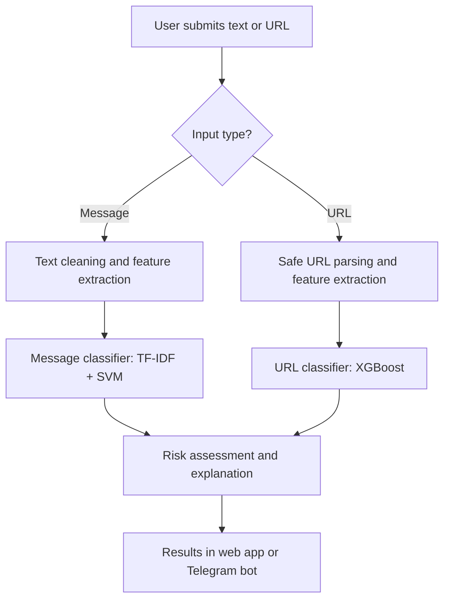

# ScamShield AI — Machine Learning Dataset & Implementation Guide

> **Project:** ScamShield AI — Intelligent Scam Detection Platform  
> **Purpose:** Detect suspicious messages and phishing URLs, including messages submitted through a website or Telegram bot.  
> **Primary context:** Malaysia (Bahasa Melayu, English, and mixed-language messages).

## 1. Project overview

ScamShield AI combines **message classification**, **phishing URL detection**, and an **explainable risk assessment**. It should flag potentially suspicious content while being transparent that predictions are not proof of fraud or safety.

### Proposed capabilities

- Detect suspected scams in SMS, pasted WhatsApp messages, and Telegram messages.
- Assess URLs for phishing indicators.
- Identify common scam themes: fake parcels, account verification, impersonation, prizes, suspicious jobs, and investment claims.
- Show a risk level and a short human-readable explanation.
- Support Malay, English, and code-switched text after suitable local evaluation.
- Avoid automatically opening or visiting user-submitted links during analysis.

## 2. Recommended datasets

| Dataset | Main task | Labels / notes | Source |
|---|---|---|---|
| **SMS Phishing Dataset** | Smishing detection | Legitimate, spam, and smishing; reported ~5,971 messages | [Mendeley Data](https://data.mendeley.com/datasets/f45bkkt8pr/1) |
| **Balanced Spam and Smishing Dataset** | Multi-class message classification | Reported ~10,191 messages across three balanced categories; synthetic examples require real-world validation | [Mendeley Data](https://data.mendeley.com/datasets/vmg875v4xs/1) |
| **UCI SMS Spam Collection** | Baseline message classifier | 5,574 messages labelled `ham` or `spam` | [UCI Repository](https://archive.ics.uci.edu/dataset/228/sms+spam+collection) |
| **LegitPhish URL Dataset** | Phishing URL classification | Reported ~101,000 legitimate/phishing URLs with URL-derived features | [Mendeley Data](https://data.mendeley.com/datasets/hx4m73v2sf/2) |
| **Financial Scams Detection Dataset** | Financial-scam text detection | Financial-scam themes; English/Bangla examples are not a substitute for Malay data | [Mendeley Data](https://data.mendeley.com/datasets/znsk27yk3h/2) |

**Dataset diligence:** Counts and column schemas can change between versions. Inspect each downloaded dataset, confirm licensing and permitted uses, review class definitions, and record the download date and version before training. Do not assume that datasets share a common label scheme.

### Best starting combination

1. **SMS Phishing Dataset** for an initial scam/spam/legitimate message classifier.
2. **LegitPhish URL Dataset** for a separate phishing URL model.
3. **Locally curated Malaysian examples** for Malay/code-switched testing and eventual retraining.

The UCI SMS Spam Collection is an excellent simple baseline, but its `spam` label does **not** specifically mean `scam`: ordinary advertising spam and fraud must not be treated as equivalent without further annotation.

## 3. Mapping datasets to ScamShield AI features

| Feature | Data source | Recommended first model | Example output |
|---|---|---|---|
| SMS message analysis | SMS Phishing | TF-IDF + Linear SVM | `smishing`, `spam`, `legitimate` |
| WhatsApp pasted message analysis | SMS Phishing + curated local examples | TF-IDF + Linear SVM | Message risk and likely theme |
| Telegram bot text checker | Same message model via API | Inference endpoint | Warning + explanation |
| Phishing link checker | LegitPhish | XGBoost or Random Forest | Phishing likelihood |
| Financial scam theme detection | Financial Scams + curated examples | Multilingual transformer (later phase) | Suspected scam category |
| Malay/English/code-switch support | Consented, anonymized Malaysian messages | Multilingual model (later phase) | Language-appropriate explanation |

> **Important:** A dataset collected from one medium does not automatically make a model reliable on another. Evaluate independently on Telegram, WhatsApp-style, Malaysian Malay, and code-switched examples before claiming support.

## 4. Machine learning pipeline



### A. Message preprocessing

- Normalize Unicode and whitespace while retaining meaningful indicators (currency symbols, URLs, unusual punctuation).
- Replace sensitive personal information in stored training examples with placeholders.
- Extract features using word and character **TF-IDF n-grams**.
- Keep slang, Malaysian abbreviations, and code-switched phrases where useful.
- Split training and test data **before** fitting vectorizers or other learned preprocessing.

### B. URL preprocessing

- Parse the URL without fetching it.
- Extract features such as length, hostname length, number of subdomains, digit ratio, special characters, and lexical patterns.
- Treat shortened links, uncommon domains, and HTTPS presence as **signals, not proof** of safety or fraud.
- Keep any threat-intelligence lookups separately from model predictions and be mindful of privacy when submitting user URLs to external services.

## 5. Experimental plan

### Message model experiments

| Experiment | Features | Classifier | Purpose |
|---|---|---|---|
| M1 | Word TF-IDF | Multinomial Naive Bayes | Fast baseline |
| M2 | Word + character TF-IDF | Logistic Regression | Interpretable comparison |
| M3 | Word + character TF-IDF | Linear SVM | Recommended initial candidate |
| M4 | Tokenized text | Multilingual transformer | Future Malay/code-switch improvement |

### URL model experiments

| Experiment | Features | Classifier | Purpose |
|---|---|---|---|
| U1 | URL lexical features | Logistic Regression | Baseline |
| U2 | URL lexical features | Random Forest | Nonlinear comparison |
| U3 | URL lexical features | XGBoost | Recommended candidate if testing supports it |

**Recommended split:** Start with 80% train / 20% held-out test, stratified where appropriate. Reserve a validation split or use cross-validation **within training data** for tuning. Deduplicate near-identical messages and related URLs before splitting to reduce leakage. Where available, group by campaign, source, or domain, and use a more recent or independent dataset as a final external test.

### Required evaluation metrics

- **Precision:** Of flagged messages, how many were truly scams?
- **Recall:** Of actual scams, how many were caught?
- **F1-score:** Balance between precision and recall.
- **Confusion matrix:** Which classes are confused?
- **Per-class results:** Especially smishing versus ordinary spam.
- **False-positive rate:** Critical because warning on legitimate messages can be disruptive.
- **Calibration:** Check whether risk probabilities meaningfully correspond to observed outcomes.

Do not report target accuracy as an achieved result without an actual evaluation. Record exact dataset versions, sample counts, random seeds, hyperparameters, and measured metrics.

## 6. Malaysian dataset extension

Public international datasets may underrepresent Malaysian scam language and local context. Build a **separately documented local test set** and, when permission allows, an additional training set.

### Proposed CSV structure

```csv
message,label,scam_type,language,source_type
"Your parcel delivery failed. Verify your details.",scam,parcel,en,synthetic
"Tahniah anda memenangi hadiah. Sila sahkan akaun.",scam,prize,ms,synthetic
"Your appointment is confirmed for tomorrow.",legitimate,none,en,synthetic
"Jom study group pukul 8 malam.",legitimate,none,ms,synthetic
"Your bank account needs urgent verification.",scam,banking,en,synthetic
```

These rows are **illustrative synthetic records**, not verified real incidents. Wording alone is often ambiguous; real labels should depend on trusted context or adjudicated evidence. Include legitimate messages with links, urgency, banking terms, and parcel notifications so the classifier does not learn simplistic shortcuts.

### Suggested collection practices

1. Gather messages only with appropriate permission or from sources that permit reuse.
2. Remove names, phone numbers, account numbers, addresses, verification codes, and other personally identifying details.
3. Record provenance, collection date, language, label criteria, and permitted use.
4. Use at least two independent reviewers for uncertain examples when feasible.
5. Keep real and synthetic samples identifiable in metadata.
6. Maintain a separate Malaysian-only evaluation set to test generalization.

A first-stage **collection goal** might be 1,000–2,000 locally reviewed examples, not a claim that such a dataset already exists.

## 7. Suggested backend integration

```text
scamshield-ai/
├── data/
│   ├── raw/                   # downloaded data; do not commit private messages
│   ├── processed/
│   └── malaysia_eval/
├── notebooks/
│   ├── 01_dataset_exploration.ipynb
│   ├── 02_message_model.ipynb
│   └── 03_url_model.ipynb
├── ml/
│   ├── preprocess_text.py
│   ├── url_features.py
│   ├── train_message.py
│   ├── train_url.py
│   └── evaluate.py
├── api/
│   └── main.py               # FastAPI prediction routes
├── bot/
│   └── telegram_bot.py       # Telegram bot integration
├── models/                   # versioned saved model artifacts
├── requirements.txt
└── README.md
```

### Suggested API contracts

**POST `/api/analyze/message`**

```json
{
  "message": "Your account needs urgent verification."
}
```

**POST `/api/analyze/url`**

```json
{
  "url": "https://example.com/account-check"
}
```

**Illustrative response** (not a real prediction):

```json
{
  "classification": "suspicious",
  "risk_level": "review",
  "confidence": null,
  "indicators": ["urgent account-verification request"],
  "disclaimer": "Automated assessment; verify through official channels."
}
```

Do not display arbitrary percentage confidence values as calibrated scam probabilities. Output risk levels only after defining and validating their thresholds.

## 8. Telegram integration concept

1. A user sends a message or link to the ScamShield AI bot.
2. The bot sends the submitted content to the appropriate **prediction endpoint** over HTTPS.
3. The service classifies the message or URL without opening suspicious destinations.
4. The bot returns a short risk assessment, relevant indicators, and safe verification advice.
5. The system minimizes retention of submitted messages and does not log sensitive content by default.

Example user-facing explanation:

> **Potential scam detected.** This message requests urgent account verification. Avoid sharing passwords or one-time codes. Confirm any account issue using the organization's official app or website.

## 9. Development phases

| Phase | Goal | Deliverable |
|---|---|---|
| 1 | Download and inspect datasets, labels, and licenses | Data dictionary and class distribution |
| 2 | Train baseline message models | Evaluated message classifier |
| 3 | Train phishing URL classifiers | Evaluated URL classifier |
| 4 | Implement inference API | FastAPI endpoints and tests |
| 5 | Connect web interface and Telegram bot | End-to-end working prototype |
| 6 | Build Malaysian external evaluation set | Language-specific metrics and error analysis |
| 7 | Improve calibration, thresholds, and explanations | More reliable warnings and documentation |

## 10. Final recommendation

Build **two separate models first**: a **TF-IDF + Linear SVM** message classifier trained on the SMS Phishing Dataset, and a **Random Forest or XGBoost** phishing URL classifier trained on LegitPhish. Compare against simpler baselines before selecting a final model. Integrate both behind a FastAPI service and expose predictions through ScamShield AI's website and Telegram bot. Treat Malaysian-language performance and safe risk explanations as major project evaluation goals.

---

*Prepared as a practical project guide. Verify current dataset availability, licenses, versions, and class distributions on their source pages before use.*
