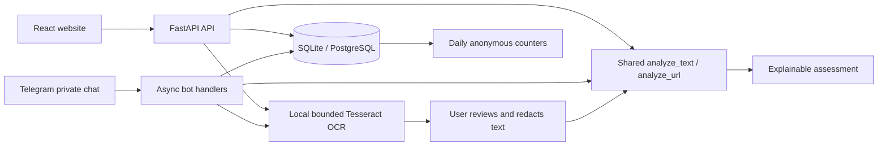

# Architecture and data

The bot is a separate worker importing the same detection service as the API, with the same database URL. It does not duplicate rules or require an HTTP call to the API. Migrate the database before starting either worker. Local development uses polling; python-telegram-bot supports secret-authenticated production webhooks.

Web OCR returns extracted text for user review before the text endpoint; the bot asks users to resubmit reviewed text. Images are temporary and no pending per-user OCR data is stored by the bot.

## Relational tables

Initial versioned migration: `backend/migrations/versions/b2a9bec8eec3_initial_schema.py`.

| Table | Purpose and constraints |
| --- | --- |
| users | UUID, unique email index, Argon2 hash, role, preferences JSON |
| sessions | Hashed random token, user FK cascade, expiry index |
| scan_records | UUID assessment ID, owner FK cascade/index, opted-in text, risk FK, assessment JSON, creation index |
| risk_classifications | Reference risk definitions |
| scam_categories | Reference category definitions |
| threat_indicators | Baseline definitions for inspection; runtime rules remain code-versioned |
| learning_modules | Bilingual lesson content; seed inserts only missing rows |
| quiz_questions | Module FK cascade; question, correct answer, explanation JSON |
| quiz_attempts | UUID, optional user FK cascade, module FK, stage, trusted score; guests have no user ID |
| awareness_metrics | Unique daily channel/risk/category/language counters, atomic upsert |
| notices | Administrator-written public notices |
| admin_audit_logs | UUID, actor FK set-null, action, target ID, timestamp; no submitted scan text |

SQLite enables foreign keys and secure_delete. SQLAlchemy uses parameter binding. PostgreSQL uses psycopg and native conflict upserts. Seeding initializes definitions and eight fictional lessons, without fake activity.

Raw scan content is not retained without explicit authenticated consent. Authorization is enforced independently of frontend routes. Theme/language and guest completion markers are local browser preferences. Signed-in learning loads successful post-assessment attempts through `/education/progress` to recover completed lessons across devices. Chart-range preferences are saved to the account. No external AI, URL fetches, government API or threat feed is active. ML preparation is isolated from the default rules runtime.
